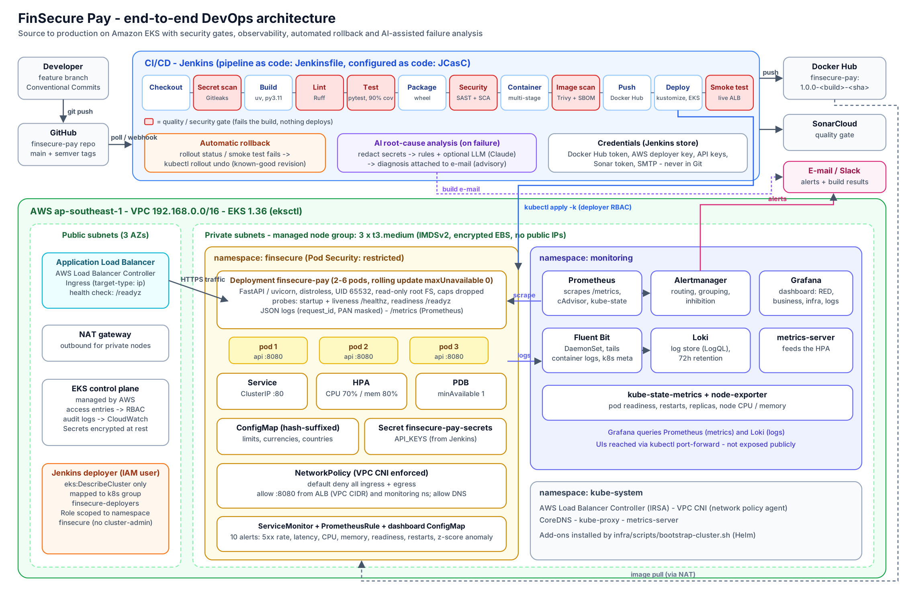

# FinSecure Pay — Cloud-Native DevOps Pipeline

A transaction validation API for a fintech start-up, delivered from source code to
Amazon EKS by an automated, security-gated Jenkins pipeline — with monitoring,
alerting, centralised logging, automatic rollback and AI-assisted failure analysis.



| | |
|---|---|
| **App** | Python 3.11 · FastAPI · 86 tests · 100 % coverage |
| **Pipeline** | Jenkins (Jenkinsfile + JCasC): 12 stages, 6 blocking gates, auto-rollback |
| **Security** | Gitleaks · Ruff · Bandit · SonarCloud · Trivy (deps, IaC, image, SBOM) · pip-audit |
| **Runtime** | Distroless non-root image · EKS 1.36 · ALB · HPA · PDB · NetworkPolicy · Pod Security `restricted` |
| **Observability** | Prometheus · Grafana · Alertmanager → e-mail/Slack · Fluent Bit → Loki · 10 tested alerts |
| **AI** | Root-cause analysis of failed builds (rules + optional LLM) · z-score traffic anomaly alert |

Documentation: [Design document](docs/design-document.md) ·
[Demo runbook & evidence checklist](docs/demo-runbook.md) ·
[Operations runbook](docs/operations-runbook.md) · [AI prototype](ai/README.md)

---

## API

| Method & path | Description |
|---|---|
| `POST /api/v1/transactions/validate` · `POST /validate` | Validate a transaction. `200 APPROVED` · `422 DECLINED` (+ reason codes) · `400` malformed · `401` missing/invalid `X-API-Key` |
| `GET /health` | Health summary + version |
| `GET /healthz` | Liveness probe |
| `GET /readyz` | Readiness probe (`503` when config invalid or draining) |
| `GET /metrics` | Prometheus metrics |
| `GET /docs` | Swagger UI (disable with `ENABLE_API_DOCS=false`) |

```bash
curl -s -X POST http://localhost:8080/validate -H 'Content-Type: application/json' -d @demo/approved.json
# {"transaction_id":"7c9e…","decision":"APPROVED","reasons":[],"risk_level":"LOW","requires_review":false,"card_last4":"****1111",...}

curl -s -X POST http://localhost:8080/validate -H 'Content-Type: application/json' -d @demo/declined.json
# {"decision":"DECLINED","reasons":["AMOUNT_EXCEEDS_LIMIT","UNSUPPORTED_CURRENCY","INVALID_CARD_NUMBER","CARD_EXPIRED","BLOCKED_COUNTRY"],"risk_level":"HIGH",...}
```

**Validation rules:** amount > 0 and ≤ limit · correct decimal places per currency (JPY = 0) ·
allowed ISO-4217 currency · card number 13–19 digits passing Luhn · card not expired ·
merchant ID `MER-XXXXXX` · ISO-3166 country not blocked · no duplicate `transaction_id`
within the window. High-value approvals are flagged `requires_review`. Card numbers are
masked in responses and logs.

## Configuration

| Variable | Default | Source in Kubernetes |
|---|---|---|
| `APP_ENV` | `local` | ConfigMap |
| `LOG_LEVEL` | `INFO` | ConfigMap |
| `MAX_TRANSACTION_AMOUNT` | `10000` | ConfigMap |
| `REVIEW_THRESHOLD` | `5000` | ConfigMap |
| `ALLOWED_CURRENCIES` | `SGD,USD,EUR,GBP,MYR,JPY` | ConfigMap |
| `BLOCKED_COUNTRIES` | `KP,IR` | ConfigMap |
| `DUPLICATE_WINDOW_SECONDS` | `300` (0 disables) | ConfigMap |
| `ENABLE_API_DOCS` | `true` | ConfigMap |
| `CHAOS_ERROR_RATE` | `0` (0–1, demo fault injection) | ConfigMap |
| `API_KEYS` | empty = auth off | **Secret** (from Jenkins credential) |
| `PORT` / `HOST` | `8080` / `0.0.0.0` | image |

Invalid values never crash the app: it starts, logs the problem and reports **not ready**,
so Kubernetes keeps the previous version serving.

## Run locally

**Prerequisites:** Python 3.11+, Docker. (Windows: PowerShell works for Python; use WSL2 or
the Jenkins container for the shell scripts.)

```bash
python -m venv .venv && . .venv/bin/activate          # Windows: .venv\Scripts\activate
pip install --require-hashes -r requirements.txt -r requirements-dev.txt
python -m app                                          # http://localhost:8080/docs
```

**Tests and checks** (the same commands the pipeline runs):

```bash
pytest --cov                     # unit + integration tests, fails under 90 % coverage
pytest ai/tests                  # AI analyser tests
ruff check . && ruff format --check .
bandit -c pyproject.toml -r app
scripts/test-alert-rules.sh      # needs promtool: unit-tests the Prometheus alerts
```

**Container:**

```bash
docker build -t finsecure-pay:local .
docker run --rm -p 8080:8080 finsecure-pay:local
curl localhost:8080/health       # {"status":"UP",...}

docker compose --profile monitoring up --build   # + Prometheus :9090, Grafana :3000
python scripts/load-test.py --url http://localhost:8080 --rps 20 --duration 120
```

## Deploy to AWS EKS

> Cost: roughly US$8/day while running. Tear down with `infra/scripts/teardown.sh`.

**1. AWS setup (once).** Create the least-privilege deployer user Jenkins will use:

```bash
aws iam create-user --user-name finsecure-jenkins-deployer
aws iam put-user-policy --user-name finsecure-jenkins-deployer \
  --policy-name eks-describe --policy-document file://infra/iam/jenkins-deployer-policy.json
aws iam create-access-key --user-name finsecure-jenkins-deployer   # -> jenkins/.env
```

**2. SonarCloud (once).** At sonarcloud.io, import the GitHub repo with project key
`finsecure-pay`, then set *Administration → Analysis Method* to **CI-based** (turn
*Automatic Analysis* off — SonarCloud rejects pipeline scans while it is on).

**3. Jenkins.** Fill in `jenkins/.env` from `jenkins/.env.example`, then:

```bash
docker compose -f jenkins/docker-compose.yml up -d --build   # http://localhost:8081
```

The image contains every CLI the project needs (aws, eksctl, kubectl, helm, kustomize,
trivy, gitleaks, sonar-scanner, uv), so the cluster scripts can run inside it too:
`docker compose -f jenkins/docker-compose.yml exec jenkins bash`.

**4. Cluster + platform add-ons** (EKS, ALB controller, metrics-server,
Prometheus/Grafana/Alertmanager, Loki, Fluent Bit) — 20–25 minutes:

```bash
export AWS_ACCOUNT_ID=123456789012 ALERT_EMAIL_TO=you@example.com \
       SMTP_USERNAME=you@gmail.com SMTP_PASSWORD='<gmail app password>' \
       SLACK_WEBHOOK_URL='<optional>'
infra/scripts/bootstrap-cluster.sh
```

**5. Deploy.** Run the `finsecure-pay` job in Jenkins (afterwards every push to `main`
deploys automatically). Get the public URL:

```bash
kubectl -n finsecure get ingress finsecure-pay
```

## CI/CD pipeline

```
Checkout → Secret Scan → Build → Lint → Unit & Integration Tests → Package
  → Security Checks [Bandit | SonarQube | Dependency Scan | IaC Scan]
  → Container Build → Image Scan → Push → Deploy to EKS → Smoke Test
```

| Gate | Fails the build when |
|---|---|
| Secret Scan | Gitleaks finds a secret anywhere in Git history |
| Lint | Ruff lint or format violations |
| Tests | Any test fails or coverage < 90 % |
| Security Checks | HIGH Bandit finding, failed Sonar quality gate, HIGH/CRITICAL dependency CVE, CRITICAL IaC misconfiguration |
| Image Scan | HIGH/CRITICAL fixable vulnerability in the image |
| Deploy / Smoke Test | New pods not Ready within 180 s or live smoke test fails → **automatic `kubectl rollout undo`** |

Manual rollback: *Build with Parameters* → `ACTION=rollback` (optional `ROLLBACK_REVISION`).
On failure the AI analyser attaches a root-cause diagnosis to the e-mail.

Credentials (Jenkins store, never in Git): `dockerhub-credentials`, `aws-deployer`,
`finsecure-api-keys`, `sonar-token`, `smtp-credentials`, optional `anthropic-api-key`.

## Monitoring and alerts

Dashboard **FinSecure Pay – Service Overview** loads automatically into Grafana.
Alerts: `FinSecureHighErrorRate`, `FinSecureHighLatencyP95`, `FinSecureHighDeclineRate`,
`FinSecureTrafficAnomaly`, `FinSecureTargetDown`, `FinSecureHighCPU`, `FinSecureHighMemory`,
`FinSecurePodNotReady`, `FinSecurePodRestarting`, `FinSecureReplicasUnavailable`.
Trigger one for a demo: `scripts/trigger-alert.sh error-rate $URL $KEY`.
How to read logs: [operations runbook](docs/operations-runbook.md#accessing-logs-troubleshooting).

## Repository layout

```
app/                 FastAPI service (validation rules, metrics, JSON logging)
tests/               unit tests + integration tests against the real server
ai/                  AI root-cause analysis prototype + tests
Dockerfile           multi-stage, distroless, non-root
k8s/base/            Deployment, Service, Ingress, HPA, PDB, NetworkPolicy, ConfigMap
k8s/monitoring/      ServiceMonitor, PrometheusRule (alerts), Grafana dashboard
k8s/cluster/         namespace + least-privilege deployer RBAC (admin-applied)
k8s/overlays/eks/    EKS overlay (image tag set by Jenkins)
infra/               eksctl cluster, Helm values, IAM policy, bootstrap/teardown
jenkins/             Jenkins image, plugins, configuration-as-code, compose file
monitoring/          local Prometheus/Grafana config, alert-rule unit tests
scripts/             smoke test, load generator, alert triggers, base-image pinning
demo/                demo payloads and patches for the failure scenarios
docs/                design document, architecture diagram, runbooks
```

## Contributing

Branch from `main` (`feat/…`, `fix/…`), use [Conventional Commits](https://www.conventionalcommits.org/)
(`feat:`, `fix:`, `test:`, `ci:`, `docs:`, `chore:`), open a pull request and squash-merge to
keep history linear. Releases bump `app/__init__.py`, update `CHANGELOG.md` and are tagged `vX.Y.Z`.

To change dependencies, edit `requirements.in` and run
`pip-compile --generate-hashes --strip-extras --allow-unsafe -o requirements.txt requirements.in`.
