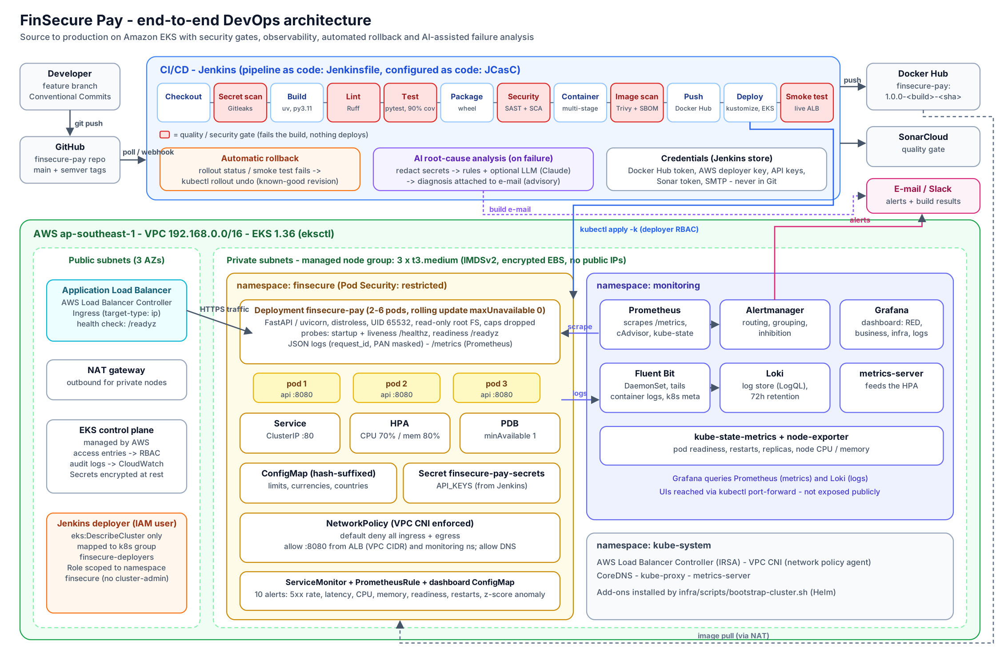

# FinSecure Pay — Design Document

**Cloud-native DevOps pipeline for a transaction validation API**
Capstone, DevOps and Cloud with AI programme · Version 1.0.0 · Repository: `github.com/htetthanthar/finsecure-pay`

---

## 1. Problem and goals

FinSecure Pay is a small fintech start-up that needs to validate card transactions through an API and ship changes quickly without breaking production. Manual deployments are slow, inconsistent and risky for a payments product. The goals were to:

| Goal | How it is met |
|---|---|
| Automate build, test and deployment | Jenkins pipeline-as-code; a push to `main` deploys to EKS with no manual steps |
| Run on Kubernetes in the cloud | Amazon EKS 1.36, 2–6 replicas behind an AWS Application Load Balancer |
| Integrate security checks | Six blocking gates: secrets, lint, tests/coverage, SAST, dependency/IaC scanning, image scanning |
| Monitor health | Prometheus + Grafana (RED, business and infrastructure metrics) and Loki for logs |
| Detect issues through alerts | 10 Prometheus alerts routed by Alertmanager to e-mail and Slack |
| Recover automatically | Probes, self-healing ReplicaSets, HPA, PDB and automatic rollback of unhealthy releases |
| Explore AI for operations | Working AI root-cause analysis of failed builds + statistical anomaly alert |

## 2. Architecture

**Flow.** A developer pushes to GitHub → Jenkins detects the change → the pipeline runs `Checkout → Secret scan → Build → Lint → Test → Package → Security checks → Container build → Image scan → Push → Deploy → Smoke test`. Any failed gate stops the run before anything reaches the cluster. The image is pushed to Docker Hub and deployed to EKS with `kubectl apply -k`. The rollout is watched; if new pods never become Ready, or the live smoke test fails, Jenkins rolls back to the previous revision. Customers reach the service through an internet-facing ALB that sends traffic directly to pod IPs.

**Network topology.** The eksctl-created VPC (`192.168.0.0/16`) spans three AZs. Public subnets hold only the ALB and a NAT gateway; worker nodes sit in private subnets with no public IPs and reach Docker Hub through the NAT. Inside the cluster a default-deny NetworkPolicy (enforced by the VPC CNI policy agent) allows port 8080 only from the VPC (ALB) and the `monitoring` namespace, and allows DNS as the only egress.

**Application.** A Python 3.11 / FastAPI microservice:

| Endpoint | Purpose |
|---|---|
| `POST /api/v1/transactions/validate` (alias `POST /validate`) | Validates a transaction → `200 APPROVED`, `422 DECLINED` with reason codes, `400` malformed, `401` bad API key |
| `GET /health` | Health summary (`UP` / `DEGRADED`) with version — used for container and smoke tests |
| `GET /healthz` | Liveness: process responsive |
| `GET /readyz` | Readiness: configuration valid and not draining (`503` otherwise) |
| `GET /metrics` | Prometheus metrics |

Validation rules: positive amount within a configurable limit; correct decimal precision per currency (JPY has none); allowed ISO-4217 currency; 13–19-digit card number passing the Luhn checksum; card not expired; merchant ID format; ISO-3166 country not on a blocked list; and duplicate-submission detection within a time window. All failing rules are returned together. High-value approvals are flagged for manual review. Card numbers are masked in every response and log line (PCI DSS 3.4).

## 3. Tool choices

| Area | Choice | Why (and alternatives considered) |
|---|---|---|
| Language / framework | **Python 3.11 + FastAPI**, pytest | The brief allows equivalents and the rubric names Python. Pydantic gives strict schema validation for free; FastAPI gives OpenAPI docs; the author can explain every line. Spring Boot/JUnit would meet the same requirements. |
| Build / dependencies | **pip-tools lock with hashes**, `uv` in CI | `--require-hashes` makes builds reproducible and blocks tampered packages (Maven equivalent: dependency lock + checksums). |
| Source control | Git + GitHub, Conventional Commits, SemVer tags | Readable history; tags drive image versions. |
| CI/CD | **Jenkins** (Jenkinsfile + JCasC + Job DSL) | Recommended tool. The whole Jenkins server is code: plugins, credentials wiring, job and e-mail config are rebuilt from `jenkins/` in one command. |
| Container | Multi-stage Docker, **distroless python3 (nonroot)** | No shell or package manager → tiny attack surface and a small image (check with `docker images`). |
| Registry | Docker Hub | Recommended; tags `<version>-<build>-<sha>` are immutable per build. |
| Orchestration | **Amazon EKS 1.36** via eksctl | Managed control plane; 1.36 is in standard support (1.33 moved to extended support at 6× the price). |
| Manifests | **Kustomize** (base + overlay + component) | Built into kubectl; content-hashed ConfigMaps give config rollback for free. Helm adds templating we don't need. |
| Ingress | **AWS Load Balancer Controller (ALB)** | ingress-nginx was retired by the Kubernetes project in March 2026; the ALB controller is the EKS-native, supported option. |
| Code quality / SAST | Ruff, Bandit, **SonarCloud** quality gate | Ruff = lint/format; Bandit = Python security rules; Sonar = bugs, smells, hotspots, coverage on new code. |
| Dependency / image / IaC | **Trivy** (+ pip-audit second opinion) | One tool for CVEs in packages and OS layers, Dockerfile/K8s misconfigurations and SBOM generation. |
| Secret detection | **Gitleaks** | Single binary, scans full Git history (equivalent to TruffleHog/GitGuardian). |
| Secrets | Jenkins credentials store → Kubernetes Secret | Nothing sensitive in Git; EKS envelope-encrypts Secrets at rest. |
| Monitoring | Prometheus + Grafana (kube-prometheus-stack) | Recommended; Operator CRDs let the app ship its own ServiceMonitor, alerts and dashboard. |
| Logging | **Fluent Bit + Loki** | Equivalent centralised logging. Elasticsearch needs several GB of heap; Loki runs in ~256 MB on t3.medium nodes and is queried from the same Grafana. |
| Notifications | Jenkins Email Extension (SMTP) + Alertmanager → e-mail/Slack | Recommended mechanism plus an external sink. |

## 4. Key design decisions

1. **Zero-downtime rolling updates.** `maxSurge: 1, maxUnavailable: 0`: a new pod must pass readiness before an old one is removed. `preStop` sleep + readiness failing on SIGTERM drain connections before shutdown.
2. **Three probes with different jobs.** *Startup* (`/healthz`, up to ~60 s) protects slow starts; *liveness* (`/healthz`, 3 × 10 s) restarts hung processes; *readiness* (`/readyz`, 2 × 5 s) removes a pod from traffic without restarting it. Invalid configuration fails readiness, not liveness, so a bad config stalls a rollout safely instead of crash-looping.
3. **Configuration as immutable, versioned objects.** Kustomize appends a content hash to the ConfigMap name, so every config change triggers a rollout and `rollout undo` restores the old configuration together with the old code.
4. **Capacity and resilience.** Requests/limits on every container; HPA 2–6 replicas on CPU 70 % / memory 80 %; PDB `minAvailable: 1`; topology spread across nodes and AZs.
5. **Stateless service, no storage class needed.** The API keeps no persistent state, so no PersistentVolumes are used. Prometheus and Loki use `emptyDir` in this demo cluster (data lost on restart); production would add the EBS CSI driver with a `gp3` StorageClass.
6. **Cluster topology.** One cluster, one managed node group of 3 × t3.medium (17 pods per node limit) is enough for the app, monitoring and logging. A single NAT gateway saves cost at the price of AZ redundancy for egress — acceptable for a capstone, not for production.
7. **Least privilege for the pipeline.** Jenkins deploys as an IAM user whose only AWS permission is `eks:DescribeCluster`; an EKS access entry maps it to the Kubernetes group `finsecure-deployers`, bound to a Role in the `finsecure` namespace. It cannot touch other namespaces, RBAC or nodes.

## 5. Security considerations (DevSecOps)

| Layer | Control | Gate behaviour |
|---|---|---|
| Source | Gitleaks scans full history | Any secret → build fails |
| Code | Ruff lint; Bandit; SonarCloud quality gate | Lint error, HIGH Bandit finding or failed gate → build fails |
| Tests | pytest unit + integration, coverage ≥ 90 % | Any failure → build fails |
| Dependencies | Trivy on the hashed lock file; pip-audit report | HIGH/CRITICAL CVE → build fails |
| IaC | Trivy config on Dockerfile + manifests | CRITICAL misconfiguration → build fails |
| Image | Trivy image scan + CycloneDX SBOM | HIGH/CRITICAL with a fix available → push blocked |
| Runtime | distroless, UID 65532, read-only root FS, all capabilities dropped, seccomp, no SA token, Pod Security `restricted` | Admission rejects non-compliant pods |
| Network | Private nodes, default-deny NetworkPolicy, IMDSv2 only, pods blocked from node IMDS | — |
| Secrets | Jenkins credentials → K8s Secret, Alertmanager reads secrets from mounted files, `.env` git-ignored | Never in Git or images |
| Data | API key auth (constant-time compare); PAN masked in responses and logs (two layers); no PAN stored | — |
| Audit | EKS control-plane audit logs → CloudWatch; Jenkins build history; image revision labels | — |

**Security gate demonstration.** Adding `requests==2.19.1` (CVE-2018-18074, HIGH) makes the Dependency Scan stage fail and nothing is deployed; upgrading to the fixed version passes the gate (see `docs/demo-runbook.md`).

## 6. Recovery considerations

| Failure | Detection | Recovery |
|---|---|---|
| Pod crash / deleted | ReplicaSet controller | New pod scheduled automatically (seconds) |
| Process hang | Liveness probe | Container restarted |
| Node / AZ loss | Node controller | Pods rescheduled; spread + PDB keep ≥1 serving |
| Traffic spike | HPA (metrics-server) | Scales out to 6 pods |
| Bad config or code in a release | Readiness → `rollout status` timeout (180 s) | Jenkins runs `rollout undo` automatically; old pods never stopped serving |
| Release passes probes but misbehaves | Post-deploy smoke test | Automatic `rollout undo` |
| Need to revert a released version | Operator decision | Jenkins `ACTION=rollback` (optionally `--to-revision`); 10 revisions retained |
| Elevated errors / latency / not-ready pods | Prometheus alerts | Alertmanager e-mail/Slack with runbook links (`docs/operations-runbook.md`) |

## 7. Monitoring, alerting and logging

**Metrics.** The app exports RED metrics per route template (bounded cardinality), decisions and decline reasons, review flags, readiness and build info; cAdvisor and kube-state-metrics add CPU, memory, restarts, readiness and replica counts.
**Dashboard.** *FinSecure Pay – Service Overview* (19 panels): request rate, 5xx rate, p95 latency, ready pods, approval rate, firing alerts; status breakdown; latency percentiles; decisions and decline reasons; CPU and memory against limits; replicas vs HPA; restarts; live logs.
**Alerts** (unit-tested with `promtool test rules`): high 5xx rate, p95 latency, high decline rate, traffic z-score anomaly, target down, CPU > 80 % of limit, memory > 85 %, pod not ready (readiness probe), restarting pods (liveness), replicas unavailable. Critical alerts inhibit related warnings.
**Logging.** Every line is a single JSON object with `timestamp, level, logger, message, request_id, version` plus structured fields (`decision, reasons, duration_ms, status`…). Fluent Bit ships them to Loki; `X-Request-ID` lets one request be traced end to end.

## 8. AI use case — AI-assisted root-cause analysis of pipeline failures

**Problem and why AI.** When a pipeline fails, an engineer must read hundreds of log lines from many tools (pytest, Ruff, Trivy, Gitleaks, Sonar, kubectl) to find the cause. This is slow, needs broad knowledge, and recurs. Failure logs are unstructured text with endless variations — exactly where a language model adds value over fixed rules: it can explain *why* a test failed or *which* upgrade fixes a CVE in plain language. Rules alone handle known signatures well, so a hybrid is used.

**Inputs.** The Jenkins console log of the failed build (last 3,000 lines); the name of the failing stage; tool output already in the log (Trivy tables, pytest assertions, kubectl errors); and a rule-based pre-classification. Future inputs: the Git diff of the commit, alert payloads from Alertmanager, and recent metrics.

**How it works (implemented in `ai/rca/analyze.py`).**
1. *Redact* AWS keys, tokens, passwords, JWTs, private keys, Slack webhooks and card numbers.
2. *Extract* the failing stage and an error window (≤ 12 KB) — data minimisation.
3. *Classify* with 16 deterministic signatures (test failure, coverage, lint, SAST, quality gate, vulnerable dependency, image CVE, IaC, secret leak, registry auth, image pull, rollout failure, RBAC, cloud auth, lock-file, smoke test), extracting evidence such as `requests 2.19.1 → fixed in 2.20.0 (CVE-2018-18074, HIGH)`.
4. *Reason* (optional): if an `anthropic-api-key` credential exists, Claude receives the redacted excerpt plus the rule hint and must return strict JSON — category, root cause, evidence quotes, remediation steps, confidence, `needs_human`. The prompt forbids inventing CVEs/files and forbids recommending that a security gate be disabled.
5. *Deliver* the diagnosis in the failure e-mail and as `rca.md` / `rca.json` build artifacts.

**Expected benefits.** Lower mean time to recovery (diagnosis arrives with the failure notification); less context-switching between tools; consistent remediation guidance (e.g. always rotate a leaked key, never just delete it); a labelled dataset of failures (`rca.json`) for trend analysis; junior engineers get senior-level hints.

**Limitations, risks and governance.**
- *Hallucination* → advisory only, never acts; must cite log evidence; confidence shown; falls back to rules on any error; humans approve every change.
- *Data leakage* → redaction before sending, excerpt not full log, no customer data in build logs, API key held in Jenkins credentials; a self-hosted model could replace the API for stricter regimes.
- *Prompt injection* via log content (e.g. a malicious test name) → model output is only displayed, never executed; JSON is validated and truncated.
- *Availability and cost* → 30 s timeout, small excerpt, cheap model by default, works fully offline in rule mode.
- *Accountability* → outputs are archived per build for audit; accuracy can be measured by comparing `category` with the engineer's eventual fix.

**Integration.** Runs in the Jenkinsfile `post { failure { … } }` block; output is added to the Email Extension notification and archived. The same analyser can be called from an Alertmanager webhook receiver to summarise alerts with recent logs. The `FinSecureTrafficAnomaly` alert already applies statistical anomaly detection (z-score over a 1-hour baseline) as a first AIOps step; a production ML model (e.g. seasonal forecasting or isolation forest over transaction metrics for fraud-pattern detection) is the next step but not required here.

## 9. Validation against the core test cases

| Test case | Expected result | Evidence |
|---|---|---|
| Run unit tests | Pass | 86 app tests + 29 AI tests, 100 % app coverage; Jenkins *Tests* tab |
| Controlled failing test | Pipeline fails, no deploy | `demo/01-failing-test.patch` → red Test stage, later stages skipped |
| Container `/health` | Healthy | `docker run` + `curl /health` → `{"status":"UP"}`; Docker `healthy` |
| Inspect deployment | ≥ 2 pods Ready | `kubectl get pods` |
| New version | Rollout completes | Bump version → pipeline → `rollout history` shows new revision |
| Delete a pod | Recreated | `kubectl delete pod` → new pod Ready in seconds |
| Critical/high finding | Gate blocks | `demo/02-vulnerable-dependency.patch` → Dependency Scan fails |
| Monitoring condition | Alert + notification | `scripts/trigger-alert.sh error-rate` → FinSecureHighErrorRate → e-mail/Slack |

## 10. Lessons learned and future improvements

**Lessons.** (1) Readiness vs liveness matters: putting config validation in readiness turned a potential crash-loop into a safe, self-reverting rollout. (2) Hashing ConfigMaps is what makes rollback complete — undoing code without config is only half a rollback. (3) Security gates must be fast and low-noise or teams bypass them; gating on HIGH/CRITICAL with fixes available keeps signal high. (4) Writing alerts as tested code (`promtool test rules`) caught threshold mistakes before they reached production. (5) Ecosystem facts change: ingress-nginx's retirement and EKS version pricing changed design choices.

**Future improvements.** External Secrets Operator with AWS Secrets Manager instead of pipeline-created Secrets; Redis/ElastiCache for cross-pod duplicate detection (today it is per pod); canary or blue-green releases with Argo Rollouts and automated analysis; GitOps with Argo CD; TLS with ACM and AWS WAF on the ALB; image signing (Cosign) and admission verification; dedicated Jenkins agents (or Kaniko) instead of the Docker socket; persistent EBS storage and Thanos/Grafana Cloud for long-term metrics; multi-AZ NAT; SLO-based burn-rate alerts; extending the AI analyser to alert summarisation and evaluating its accuracy on real failures.
